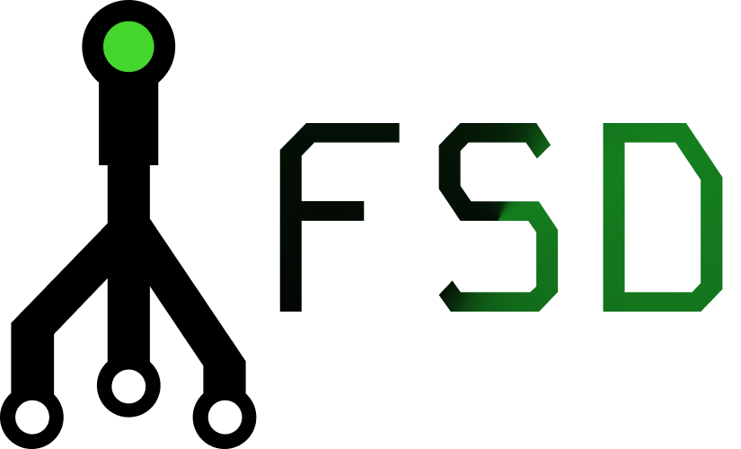

<p align="center">
  
</p>

<p align="center">
  <a href="https://pypi.org/project/forktex-fsd/"></a>
  <a href="https://pypi.org/project/forktex-fsd/"></a>
  <a href="https://github.com/forktex/forktex-fsd/blob/master/LICENSE"></a>
</p>

# forktex-fsd

**FSD**, the ForkTex Standard of Delivery, is a technology-agnostic standard for
how a repository is set up, checked, built and shipped, and `fsd` is the small
tool that holds a repository to it.

A repository binds the standard's atoms, such as `test`, `audit`, `build` and
`publish`, to its own commands in one `fsd.toml`. `fsd` reports what is still
missing, track by track. It runs any atom by name on Linux, macOS or Windows,
and gates delivery on the tracks that check. It works with any language and any
toolchain: the standard says what must be true, never which tool makes it so.

## Installation

```bash
uv tool install forktex-fsd      # or: pipx install forktex-fsd
```

`fsd` runs on Python 3.14; `uv tool install` brings its own, so the repository
being checked need not be Python. To use the library, add `forktex-fsd` to your
project's dependencies.

## Quick start

Put an `fsd.toml` at the root of the repository:

```toml
# fsd.toml
standard = "1.0"
profile  = "library"

[operation]
setup = "poetry install"

[assurance]
format = "ruff format --check ."
lint   = ["ruff check .", "lint-imports"]
test   = "pytest -q"

[security]
audit = "pip-audit"

[delivery]
build   = "python -m build"
publish = "twine upload dist/*"

[documentation]
manual = { file = ["README.md", "AGENTS.md"] }
```

Then:

```bash
fsd                     # every atom, its binding, and compliance per track
fsd test -k smoke       # one atom; what follows goes to its command
fsd assurance           # one track that checks: its compliance, then every atom in it
fsd report              # everything routine, without stopping: fsd-report.json and .md
```

## The standard

The standard has five **tracks**, and each is judged on its own, so strength on
one never hides a gap on another. The **profile** says how the software
reaches its user:
- a `library` is consumed as a dependency;
- an `application` is installed onto a machine;
- a `service` is deployed and operated.

The profile decides whether each atom is `must` (a gap fails its track),
`should` (a gap is a warning) or `na` (it does not apply). Each atom also has an
**effect**: what running it touches, from `read-only` to `external`.

| Track | Atom | It means | Effect | library | application | service |
|---|---|---|---|:-:|:-:|:-:|
| **operation** | `setup` | everything needed to build and run it is installed, from a fresh checkout | local | must | must | must |
| | `start` | it runs locally | local | na | na | must |
| | `stop` | what `start` brought up is torn down | local | na | na | must |
| | `status` | whether it is running, with its recent output | read-only | na | na | must |
| | `clean` | everything the build and the run produced is removed | local | should | should | should |
| **assurance** ✓ | `format` | the source layout conforms to the project's style | read-only | must | must | must |
| | `lint` | static analysis finds no defects or unsafe patterns | read-only | must | must | must |
| | `validate` | the source is statically consistent: types, schemas, contracts | read-only | should | should | should |
| | `test` | the software's own tests pass | local | must | must | must |
| | `license` | the licence is declared and applied to every source file | read-only | should | should | should |
| **security** ✓ | `audit` | dependencies are free of known vulnerabilities | read-only | must | must | must |
| **delivery** | `build` | the source becomes the deliverable artifact | local | must | must | must |
| | `install` | the artifact is put onto this machine | host | na | must | na |
| | `publish` | a versioned artifact is put where consumers fetch it | external | must | should | should |
| | `deploy` | a version is put into a named environment | external | na | na | must |
| | `rollback` | an environment returns to its previous version | external | na | na | should |
| **documentation** ✓ | `manual` | a newcomer, a person or an agent, can start from the repository alone | read-only | must | must | must |

✓ A track that checks rather than acts. It runs as a whole, as in
`fsd assurance`: first its compliance, then its atoms in order, stopping at the
first failure. Together these tracks are the gate: `fsd assurance`,
`fsd security`, `fsd documentation`. Operation and delivery act,
so their atoms run only by name. `fsd help <atom>` prints any atom's full
contract.

## Configuration

Each atom is bound under the section of its own track:

| Form | Example | Meaning |
|---|---|---|
| command | `test = "pytest -q"` | run through the platform shell: `sh`, or `cmd` on Windows |
| steps | `lint = ["ruff check .", "lint-imports"]` | run in order; the first failure stops the atom |
| with results | `test = { run = "pytest --junitxml=build/junit.xml", results = ["build/junit.xml"] }` | files `fsd report` reads: JUnit, Cobertura, SARIF |
| files | `manual = { file = ["README.md", "AGENTS.md"] }` | every file must exist |
| not applicable | `publish = { na = "an internal tool" }` | the atom does not apply here, and why |

Any other name under a track is a **custom atom** of that track, such as
`migrate` under `[operation]`. It runs by name and is listed, but it never
counts for compliance. Under a track that checks, it runs with that track.
Arguments after an atom's name go where its commands say `{args}`, quoted for
the shell. A single command without the placeholder takes them at its end, and
a list of several commands without it takes none.

## Command line

| Command | Does |
|---|---|
| `fsd` | The repository: every atom, its binding, compliance per track |
| `fsd <atom> [args...]` | Runs one atom, standard or custom |
| `fsd <track>` | Runs a track that checks: its compliance, then its atoms in order |
| `fsd report` | Runs every routine atom without stopping; writes `fsd-report.json` and `fsd-report.md` |
| `fsd help [name] [--json]` | The standard, one track, or one atom |
| `fsd --version` | The version of `fsd` and of its standard |
| `fsd -C DIR …` | Starts the search for `fsd.toml` in `DIR` instead of the current directory |

Exit codes: `0` passed, `1` not compliant or something failed, `2` invalid
input. Checking executes nothing, so bare `fsd` is safe on a repository you do
not trust.

## Python interface

```python
from forktex_fsd import Project

project = Project.find()                    # the nearest fsd.toml at or above the working directory
compliance = project.check()                # per track; executes nothing
results = project.run("assurance")          # one atom or one track
report = project.report()                   # every routine atom, with evidence
print(compliance.compliant, report.passed)
```

## Documentation

| Page | For |
|---|---|
| [Guide](docs/guide.md) | Complete, copyable setups: a library, a service, any stack, custom atoms, CI, reports, Python |
| [Reference](docs/reference.md) | The standard, `fsd.toml`, the commands, every public name and error |

## Versioning

Semantic versioning covers:
- the names in `forktex_fsd.__all__`;
- the `fsd.toml` format of each standard version;
- the `fsd` commands and their exit codes;
- the JSON of `fsd-report.json` and of `fsd help --json`.

`fsd.toml` names the standard version it was written for. `fsd` reads any file
of its own major version up to its own minor, and refuses any other, so a
change of standard is never silent. Changes are listed in the
[CHANGELOG](CHANGELOG.md).

## Contributing

Working on `forktex-fsd` itself? Start with
[`docs/development.md`](docs/development.md). Security issues go to the address
in [SECURITY.md](SECURITY.md).

## Licence

AGPL-3.0-or-later, or a commercial licence from FORKTEX S.R.L.
(info@forktex.com). See [LICENSE](LICENSE) and [NOTICE](NOTICE).
